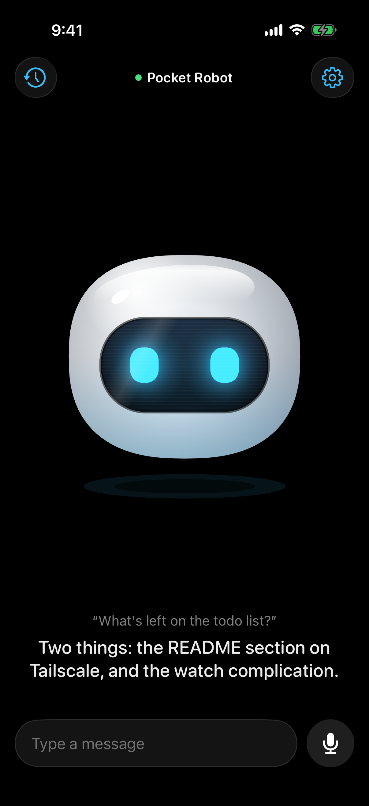
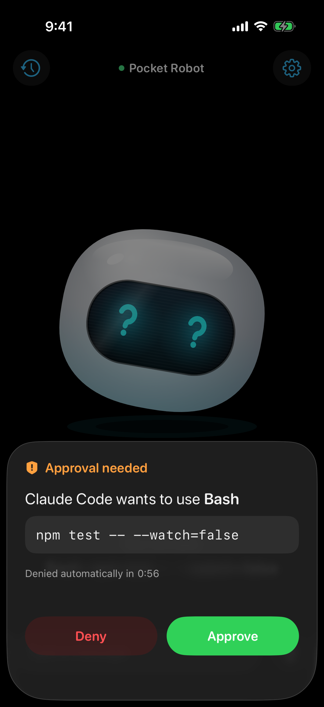

# Pocket Robot

Talk to Claude Code on your Mac from your Apple Watch or iPhone. A little robot acts out what the agent is doing: listening, thinking, working, asking, talking, done.

Hold the screen, say what you want, let go. Your Mac transcribes it, Claude Code does the work in a folder you choose, and the robot tells you what happened, out loud. When Claude wants to run a command, the robot asks first and you tap Approve or Deny.

<p>
  
  
</p>

## How it works

```
Apple Watch ─┐                                ┌─▶ whisperkit-cli (speech to text, on your Mac)
             ├──audio/text──▶ Hub on your Mac ┤
iPhone ──────┘ ◀── live state, approvals ───  └─▶ Claude Code (headless, in your workspace folder)
```

- **Apps** (`apple/`, SwiftUI, XcodeGen): the iPhone app carries the watch app and its complication.
  - The Visor robot is drawn in code with SwiftUI `Canvas` — springs, not sprites. Tap it, pet it, spin the Digital Crown.
  - iPhone: hold the mic or type, history, settings (hub address + token, pushed to the watch), approvals.
  - Watch: hold to talk, approve or deny commands. If the watch can't reach your Mac, it talks through the iPhone.
  - Complication: the robot's face on your watch face.
- **Hub** (`hub/`): a small Node server, no dependencies. It transcribes on your Mac, runs `claude -p` with streaming output, turns each step into a state the robot acts out, and asks your devices before Claude runs a gated tool.

| Agent | Robot |
| --- | --- |
| listening | eyes wide open |
| thinking | eyes glance around |
| working | loading dots in its eyes |
| waiting for approval | question marks in its eyes |
| speaking | happy, eyes bounce as it talks |
| done | star eyes, sparks, a visor roll |
| error | angry |
| offline | asleep |

## Requirements

- Mac with Apple silicon, Xcode 26, Node 20+
- iPhone on iOS 26 and/or Apple Watch on watchOS 26 (a free Apple ID can sign the apps)
- [Claude Code](https://claude.com/claude-code), signed in
- `brew install xcodegen whisperkit-cli`

## Setup

```bash
scripts/configure      # creates ~/.pocket-robot/config.json (token) and apple/Shared/Config.swift
scripts/hub            # starts the hub (keep it running)
```

Then install the apps (iPhone connected by cable, unlocked):

```bash
POCKET_ROBOT_TEAM=<your team id> scripts/install
```

The watch app follows to the paired watch (Watch app on the iPhone → My Watch, if automatic install is off). Or open `apple/PocketRobot.xcodeproj` after `cd apple && xcodegen generate` and Run.

The first transcription downloads the speech model (~250 MB) to `~/.pocket-robot/models`.

If your devices can't resolve the Mac's `.local` name, use its IP: `POCKET_ROBOT_HOST=192.168.x.y scripts/configure`, or change the address in the iPhone app's Settings (no rebuild needed).

## Away from home

Install [Tailscale](https://tailscale.com) on the Mac and the iPhone, turn on MagicDNS, and set the hub address in Settings to `http://<your-mac>.<tailnet>.ts.net:8787`. The watch uses it too, directly or through the iPhone.

## Hub API

All requests need `Authorization: Bearer <token>`.

| Method | Path | |
| --- | --- | --- |
| GET | `/health` | `{"ok":true,"busy":false,"version":2}` |
| POST | `/talk` | body `audio/*` or `text/plain`; NDJSON stream of states until the turn ends |
| POST | `/approve` | `{"id":"…","allow":true}` |
| GET | `/history` | last 50 turns |
| POST | `/new` | start a new conversation |

Details in [docs/specs/2026-10-14-pocket-robot-v2.md](docs/specs/2026-10-14-pocket-robot-v2.md). Env overrides for development: `POCKET_ROBOT_HOME`, `POCKET_ROBOT_PORT`, `POCKET_ROBOT_CLAUDE`. Tests: `npm test`.

## Safety

- Every request needs the token from `~/.pocket-robot/config.json`. It is never committed (`Config.swift` is git-ignored); the iPhone keeps it in the Keychain.
- Claude Code runs only in your workspace folder (`~/pocket-robot-workspace` by default). Reading, editing and web search run on their own; anything else (shell commands that change things, …) waits for your Approve. No answer in 60 s means no.
- Audio stays on your network and is deleted after transcription.

## License

MIT
